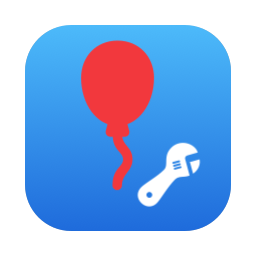
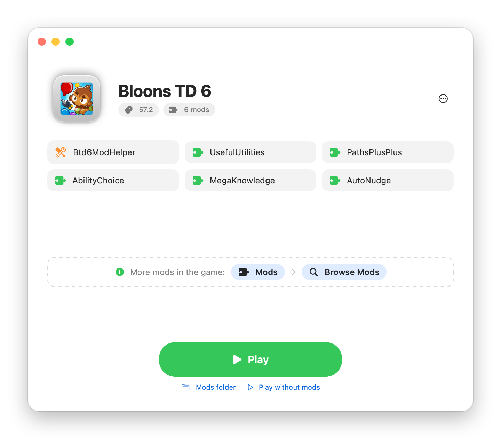
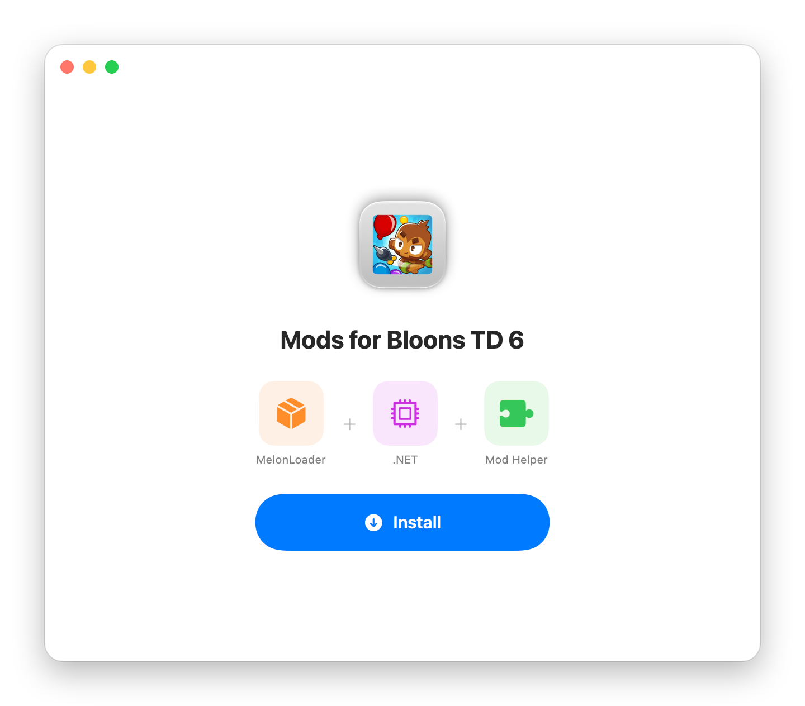
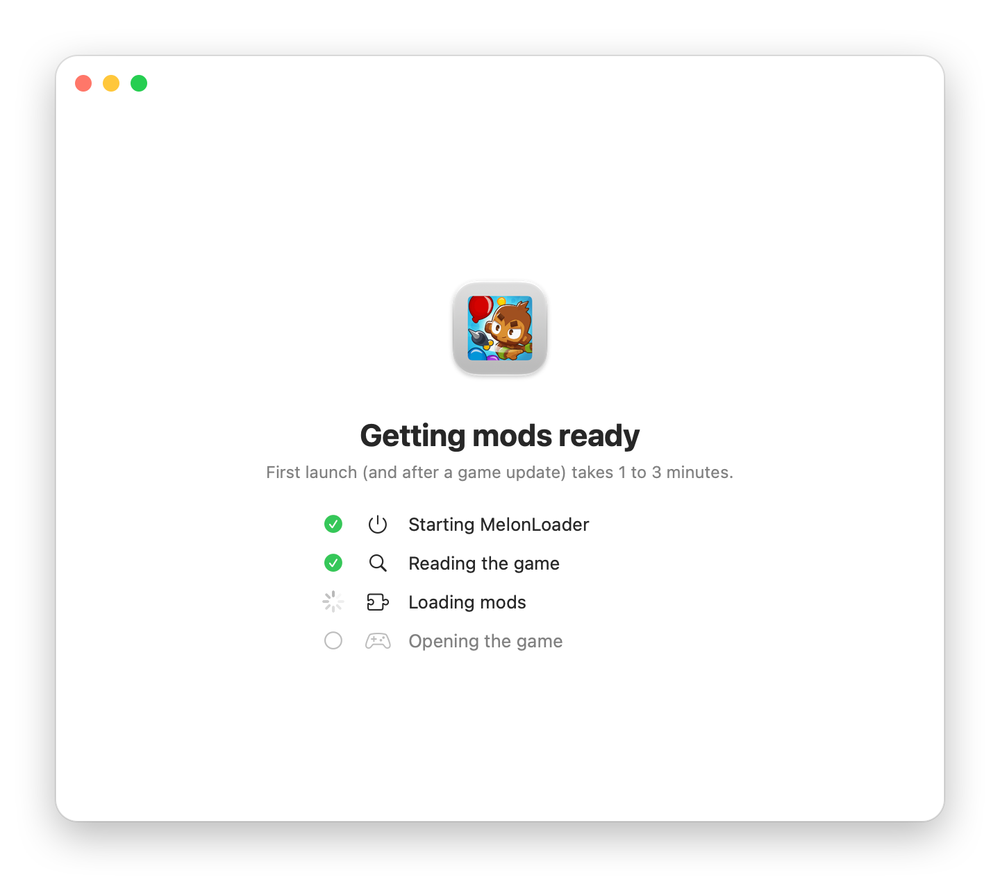
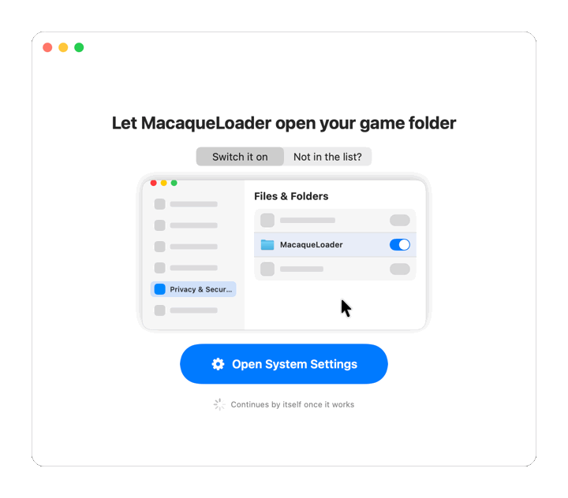
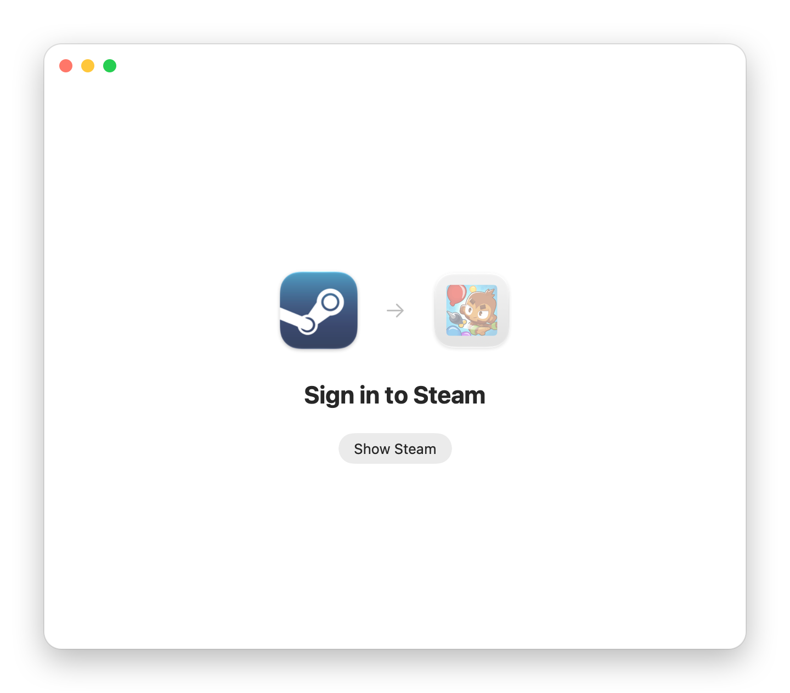

<p align="center">
  
</p>

<h1 align="center">MacaqueLoader</h1>

<p align="center">
  <b>Mods for Bloons TD 6 on Apple Silicon Macs.</b><br>
  One app sets up MelonLoader and BTD6 Mod Helper, then gives you a Play button.
</p>

<p align="center">
  <a href="https://github.com/dimslalom/btd6-macaque-mod-loader/releases/latest"></a>
  <a href="https://github.com/dimslalom/btd6-macaque-mod-loader/releases"></a>
  <a href="https://github.com/dimslalom/btd6-macaque-mod-loader/actions/workflows/build.yml"></a>
  
  <a href="LICENSE"></a>
</p>

<p align="center">
  <a href="https://github.com/dimslalom/btd6-macaque-mod-loader/releases/latest"></a>
</p>

<p align="center">
  <picture>
    <source media="(prefers-color-scheme: dark)" srcset="docs/readme/home-dark.png">
    
  </picture>
</p>

## Features

- **One click to mods.** Installs MelonLoader, the .NET runtime and BTD6 Mod Helper, then shows a Play button.
- **Your game stays untouched.** Everything goes next to `BloonsTD6.app`; Steam still starts the game without mods.
- **Mod Helper works fully:** the in-game Mods menu, the Mod Browser, one-click mod downloads.
- **Survives game updates.** After a BTD6 update, the next Play prepares everything again by itself.
- **Guides you instead of failing.** Missing Rosetta, Steam closed, a protected folder: the app shows what to do and
  continues on its own.
- **Light and dark mode,** native SwiftUI, no Terminal needed. There's a command-line tool too, if you like that.

## Install

**Download** the latest `MacaqueLoader-<version>.dmg` from [Releases](https://github.com/dimslalom/btd6-macaque-mod-loader/releases/latest),
open it, and drag **MacaqueLoader** onto **Applications**.

<details>
<summary><b>macOS says MacaqueLoader “can’t be opened”</b></summary>
<br>

MacaqueLoader isn't signed with a paid Apple developer certificate, so macOS blocks the first open of a downloaded copy.
Open **System Settings → Privacy & Security**, scroll down, and click **Open Anyway** next to “MacaqueLoader”. You only
do this once. (The Homebrew install below skips this step.)
</details>

**Homebrew**

```bash
brew install dimslalom/tap/macaqueloader
```

```bash
macaqueloader app
```

The second command puts MacaqueLoader in `~/Applications` and opens it.

## How it goes

<table>
  <tr>
    <td width="33%" align="center">
      <picture>
        <source media="(prefers-color-scheme: dark)" srcset="docs/readme/install-dark.png">
        
      </picture>
      <br><b>1. Install</b><br>MelonLoader, .NET and Mod Helper, in one click.
    </td>
    <td width="33%" align="center">
      <picture>
        <source media="(prefers-color-scheme: dark)" srcset="docs/readme/home-dark.png">
        
      </picture>
      <br><b>2. Play</b><br>Your mods at a glance. Get more in the game: <i>Mods › Browse Mods</i>.
    </td>
    <td width="33%" align="center">
      <picture>
        <source media="(prefers-color-scheme: dark)" srcset="docs/readme/preparing-dark.png">
        
      </picture>
      <br><b>3. First launch</b><br>Takes 1 to 3 minutes once (and after game updates). You see the progress.
    </td>
  </tr>
</table>

### If something is missing, it shows you what to do

<table>
  <tr>
    <td width="50%" align="center">
      <picture>
        <source media="(prefers-color-scheme: dark)" srcset="docs/readme/permission-dark.gif">
        
      </picture>
      <br><b>Steam library in Documents, Desktop, Downloads or an external drive?</b><br>
      It shows the exact switch to flip, opens that page, and continues by itself once it works.
    </td>
    <td width="50%" align="center">
      <picture>
        <source media="(prefers-color-scheme: dark)" srcset="docs/readme/steam-dark.png">
        
      </picture>
      <br><b>Steam closed?</b><br>
      It starts Steam, waits for you to be signed in, then starts the game.
    </td>
  </tr>
</table>

## Requirements

| | |
|---|---|
| Mac | Apple Silicon (M1 or newer) |
| macOS | 13 Ventura or newer (tested on macOS 27) |
| Game | Bloons TD 6 from **Steam** (tested with 57.2) |
| Rosetta 2 | Required; MacaqueLoader offers to install it |

## FAQ

<details>
<summary><b>Can this get my account banned?</b></summary>
<br>

Ninja Kiwi doesn't support modding. Cosmetic and quality-of-life mods are widely used, but mods that change gameplay
(especially in co-op, races or bosses) can get flagged. Use an alt account if you can.
</details>

<details>
<summary><b>Does it change my game files?</b></summary>
<br>

No. Nothing inside `BloonsTD6.app` is touched. The mod loader sits next to it in the game folder, and Steam's
“Verify integrity of game files” leaves it alone.
</details>

<details>
<summary><b>How do I play without mods?</b></summary>
<br>

Start Bloons TD 6 from Steam as usual, or use **Play without mods** in MacaqueLoader.
</details>

<details>
<summary><b>Where do I get mods?</b></summary>
<br>

In the game: **Mods › Browse Mods** on the main menu, with one-click downloads. You can also drop mod `.dll` files into
the `Mods` folder (MacaqueLoader has a shortcut to it). Restart the game after adding mods.
</details>

<details>
<summary><b>What happens when Bloons TD 6 updates?</b></summary>
<br>

Press Play as usual. The first launch after an update takes 1 to 3 minutes while everything is prepared for the new
version, and Mod Helper updates itself. If the new version is newer than MacaqueLoader was tested with, it tells you
some mods may need updates.
</details>

<details>
<summary><b>Why does it want to access my Documents folder?</b></summary>
<br>

Only if your Steam library is there (Steam's default location doesn't need any permission). The mod loader has to be
installed next to the game and started from there. MacaqueLoader only touches the Bloons TD 6 folder.
</details>

<details>
<summary><b>Does it work on Intel Macs, or with the Epic Games / Mac App Store version?</b></summary>
<br>

Not at the moment: MacaqueLoader supports the Steam version on Apple Silicon Macs.
</details>

<details>
<summary><b>The game closed, or something doesn't work</b></summary>
<br>

Open MacaqueLoader's **⋯** menu, choose **Repair**, and try again. If it still fails, turn on **Debug logging** in the
same menu, reproduce the problem, and [open an issue](https://github.com/dimslalom/btd6-macaque-mod-loader/issues/new?template=bug_report.md)
with these logs from the game folder:

| File | What |
|---|---|
| `MelonLoader/Latest.log` | MelonLoader and mod log |
| `_modkit/launch.log` | launch log and the game's own output |
| `melonfix.log` | native bridge log (with crash backtraces in debug mode) |
| `~/Library/Logs/MacaqueLoader.log` | install / repair log |
</details>

<details>
<summary><b>How do I uninstall?</b></summary>
<br>

**⋯ › Remove Mods** in MacaqueLoader (it asks whether to keep your mods), then drag MacaqueLoader to the Trash.
From the command line: `macaqueloader uninstall` (add `--purge` to also delete your mods and their settings).
</details>

## Command line

<details>
<summary><code>macaqueloader</code> does everything the app does, for terminal fans and scripts</summary>
<br>

```
macaqueloader app                             put the app in ~/Applications and open it
macaqueloader install [--game DIR] [--yes]    install (finds the game through Steam)
macaqueloader repair                          re-apply all files, keeps mods and settings
macaqueloader uninstall [--purge]             remove the mod loader (--purge also deletes mods and their settings)
macaqueloader launch                          start modded BTD6 (starts Steam first if needed)
macaqueloader status                          what's installed, and whether it's healthy
macaqueloader logs                            follow the game logs
macaqueloader debug on|off                    verbose logs and crash backtraces
```
</details>

## How it works

MelonLoader's macOS build doesn't work with Bloons TD 6 out of the box. Its hooks land at the wrong addresses, it
misreads which binary is the game, Cpp2IL can't read the game's universal binary, and Il2CppInterop (the bridge
between mods and the game) picks wrong functions and assumes the Windows calling convention. MacaqueLoader fixes each
of these at runtime, without touching the game:

- **`melonfix`** ([src/melonfix](src/melonfix)), a small native library loaded into the game before MelonLoader;
- **`MelonMacFixes`** ([src/MacFixes](src/MacFixes)), a MelonLoader plugin for the fixes that need managed code.

[docs/DESIGN.md](docs/DESIGN.md) walks through every problem and its fix.

<details>
<summary>What gets installed</summary>
<br>

In the game folder (`…/steamapps/common/BloonsTD6`), next to `BloonsTD6.app`:

| Path | What |
|---|---|
| `MelonLoader/`, `MelonLoader.Bootstrap.dylib` | MelonLoader 0.7.3, macOS x64 (runs under Rosetta) |
| `dotnet/` | .NET 6.0.36 runtime, osx-x64 |
| `Mods/Btd6ModHelper.dll` | BTD6 Mod Helper, latest release |
| `melonfix.dylib` | native bridge |
| `Plugins/MelonMacFixes.dll` | MelonLoader plugin |
| `_modkit/` | Cpp2IL wrapper, cache, state |

MelonLoader and .NET are downloaded from their official releases with pinned checksums.
See [THIRD_PARTY_NOTICES.md](THIRD_PARTY_NOTICES.md).
</details>

## Contributing

Bug reports and pull requests are welcome; see [CONTRIBUTING.md](CONTRIBUTING.md) for building from source, the repo
layout and how releases work.

## Thanks

MacaqueLoader stands on the work of [MelonLoader](https://github.com/LavaGang/MelonLoader) (LavaGang),
[BTD6 Mod Helper](https://github.com/gurrenm3/BTD-Mod-Helper) (doombubbles and gurrenm3),
[Il2CppInterop](https://github.com/BepInEx/Il2CppInterop) (BepInEx), [Cpp2IL](https://github.com/SamboyCoding/Cpp2IL)
(Samboy063) and [HarmonyX](https://github.com/BepInEx/HarmonyX). And of course the BTD6 modding community, whose mods
make this worth doing.

## License

MIT, see [LICENSE](LICENSE). MacaqueLoader is not affiliated with or endorsed by Ninja Kiwi. Bloons TD 6 is a
trademark of Ninja Kiwi.
